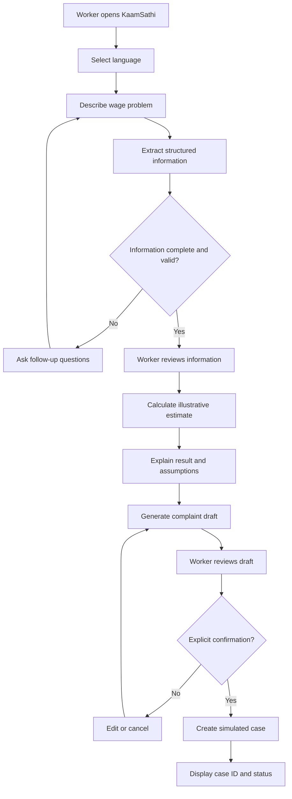
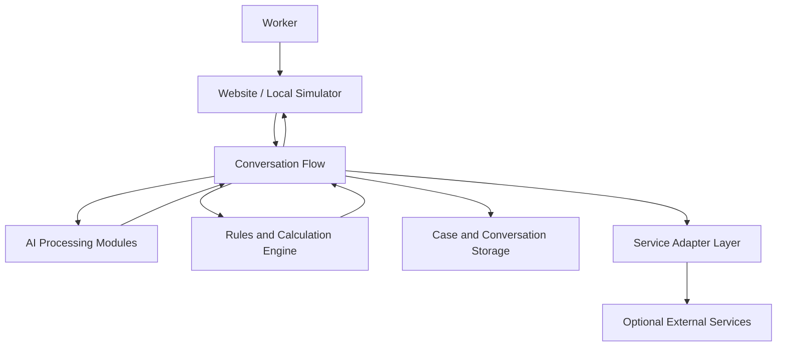

# KaamSathi — AI-Powered Wage Rights Assistant

> **Know your wage rights. Understand payment delays. Prepare your next step.**

KaamSathi is a multilingual, AI-assisted wage-rights platform designed to help rural workers understand potential wage-payment delays, estimate possible compensation under applicable rules, prepare complaint drafts, and track their cases through a simple, accessible web interface.

Built for **SARCathon 2026 / Cline AI Builder Hackathon**, KaamSathi focuses on a practical problem: workers may know that their wages are delayed without knowing how to assess the delay, understand the applicable rules, or prepare a complaint.

Our goal is to make the first step toward understanding wage rights easier, clearer, and more accessible.

**Current product direction:** Website-first application with a local demo mode. WhatsApp integration is optional and is not required for the core demonstration.

---

## Table of Contents

1. [The Problem](#1-the-problem)
2. [Our Solution](#2-our-solution)
3. [Why KaamSathi Matters](#3-why-kaamsathi-matters)
4. [Core Features](#4-core-features)
5. [Complete User Workflow](#5-complete-user-workflow)
6. [Example Demonstration](#6-example-demonstration)
7. [System Architecture](#7-system-architecture)
8. [Technology Stack](#8-technology-stack)
9. [Project Structure](#9-project-structure)
10. [Compensation Calculation](#10-compensation-calculation)
11. [AI and Multilingual Processing](#11-ai-and-multilingual-processing)
12. [Privacy, Consent and Responsible AI](#12-privacy-consent-and-responsible-ai)
13. [Installation and Setup](#13-installation-and-setup)
14. [Running the Application](#14-running-the-application)
15. [Testing](#15-testing)
16. [Demonstration Guide for Judges](#16-demonstration-guide-for-judges)
17. [Limitations and Current Scope](#17-limitations-and-current-scope)
18. [Future Roadmap](#18-future-roadmap)
19. [Hackathon Team Workflow](#19-hackathon-team-workflow)
20. [Contributing](#20-contributing)

---

## 1. The Problem

For rural workers participating in public employment programmes, delayed wage payments can create significant financial difficulties.

The challenge is not limited to the delay itself. Workers may also face difficulties understanding the relevant payment rules, determining which dates matter, estimating potential compensation, and preparing a clear complaint.

### Key challenges

**1. Limited awareness of wage rights**

Workers may not know the applicable payment deadline, what rules govern compensation for delays, or where to seek help.

**2. Difficulty assessing delays**

Determining whether a payment is delayed may require employment details, payment records, relevant dates, and the applicable official rules.

**3. Complicated complaint preparation**

Preparing a complaint requires the worker to organise relevant facts and communicate them clearly.

**4. Language and accessibility barriers**

A system that relies entirely on technical language or English can exclude people who would benefit from assistance.

**5. Lack of a clear next step**

Even after identifying a possible problem, workers may not know what information to gather or how to organise a complaint.

### The opportunity

A simple digital assistant can help workers organise their information, understand an illustrative assessment, prepare a complaint draft, and keep track of the next steps.

KaamSathi aims to provide that assistance without pretending to replace official authorities or legal verification.

---

## 2. Our Solution

KaamSathi provides a guided, conversational experience through web application.

A worker can describe a wage-payment problem in ordinary language. The system collects the necessary information, identifies missing details, validates the available data, calculates an illustrative estimate when possible, and generates a complaint draft for review.

The worker remains in control throughout the process.

### Our approach

- **Conversational:** Workers can describe their situation naturally.
- **Multilingual:** The interface is designed to support language selection and language-processing integrations.
- **Transparent:** Estimates include their inputs, assumptions, and limitations.
- **Human-controlled:** Workers review their information and complaint before confirming a simulated case.
- **Practical:** The core demonstration can run locally without WhatsApp credentials.
- **Extensible:** External services can be integrated through separate adapters.

KaamSathi is an assistance and information tool. It does not independently establish legal entitlement, guarantee compensation, or submit official claims unless a verified, authorised integration is separately implemented.

---

## 3. Why KaamSathi Matters

KaamSathi is designed to reduce the effort required to move from a confusing wage-payment situation to an organised understanding of the problem.

| Traditional difficulty | KaamSathi's intended assistance |
|---|---|
| Uncertainty about what information matters | Guided information collection |
| Incomplete or inconsistent dates | Validation and follow-up questions |
| Difficulty understanding an estimate | A transparent, understandable calculation |
| Difficulty expressing a complaint | AI-assisted complaint drafting |
| Uncertainty about the next step | A structured case summary and guidance |
| Language barriers | Language selection and supported multilingual processing |

The intended outcome is not an automated legal verdict. It is a clearer, more accessible starting point for workers seeking to understand and address a possible wage-payment issue.

---

## 4. Core Features

### 4.1 Conversational worker interface

The web interface allows workers to describe their issue without navigating complicated forms.

For example:

> My wages have not been paid. I worked under the employment programme and want to understand whether the payment is delayed.

The system should ask focused questions when information needed for assessment is missing.

### 4.2 Structured information extraction

AI can help transform a worker's message into structured information, such as:

- Employment or work details
- Wage amount
- Relevant work or payment dates
- Whether payment has been received
- Other details required by the applicable rules

Extracted information must be validated and presented for review. The application should not silently treat an AI-generated assumption as a confirmed fact.

### 4.3 Wage-delay assessment

The calculation engine uses configured rules and validated inputs to estimate a possible delay and, where justified, an illustrative compensation amount.

The engine should distinguish missing information from a genuine zero-day delay.

### 4.4 Complaint drafting

KaamSathi can use AI to organise validated information into a clear complaint draft.

The draft should contain only supported facts and should be editable by the worker before confirmation.

### 4.5 Explicit consent

A complaint draft is not a submitted complaint.

The application requires a separate, explicit confirmation action before creating a simulated case. Merely sending a message, requesting an estimate, or generating a draft does not count as consent.

### 4.6 Case tracking

After confirmation in demo mode, the application can create a simulated case ID and display a status history.

Simulated tracking demonstrates how a future case-management integration could work. It does not indicate that a government authority has received or accepted the complaint.

### 4.7 Multilingual and voice-ready architecture

The system is designed to accommodate language processing and speech transcription through available external services, including Bhashini where access and supported services permit.

Text input remains the fallback when voice processing is unavailable.

### 4.8 Local demonstration mode

The primary demonstration should work without live WhatsApp credentials or government-system access.

Sample records and simulated cases must be labelled clearly.

---

## 5. Complete User Workflow

The intended end-to-end workflow is:

1. **Open KaamSathi:** The worker visits the website and selects a preferred language.
2. **Describe the issue:** The worker enters a message about unpaid or delayed wages.
3. **Extract information:** The AI component identifies relevant fields from the message.
4. **Identify missing details:** The system asks follow-up questions when necessary.
5. **Review the information:** The worker corrects or confirms the extracted facts.
6. **Validate the inputs:** The application checks dates, amounts, payment status, and required fields.
7. **Assess the delay:** The application uses the applicable configured rules and available information.
8. **Explain the estimate:** The system presents the calculation, assumptions, and limitations.
9. **Prepare the complaint:** The AI generates a draft based on validated information.
10. **Review and confirm:** The worker reviews the draft and explicitly approves creation of a simulated case.
11. **Create the case:** The application generates a unique demo case ID and saves the case.
12. **Track progress:** The worker can reopen the case and view its recorded status.

### Workflow diagram



This is the intended product flow. The implemented application and its tests determine which stages are currently operational.

---

## 6. Example Demonstration

The following example illustrates the intended user experience. All names, amounts, dates, and results are fictional. The calculation is illustrative, not a statement of the applicable legal entitlement.

### Step 1: Worker describes the problem

**Worker:**

> I worked under MGNREGA. My wages of ₹10,000 have not been paid. Can you help me understand the delay?

**KaamSathi:**

> I can help organise your information and assess the payment delay using the available rules. First, I need a few details about the work and payment dates.

### Step 2: Collect missing information

**KaamSathi asks:**

- When was the relevant work completed or the payment process initiated?
- What payment deadline or official record is available?
- Have you received any part of the payment?
- Do you have a verified payment record or reference?

The exact questions depend on the applicable rules and the information already supplied.

### Step 3: Validate the information

The worker reviews the extracted wage amount and dates.

If the dates conflict or a required field is missing, the application asks for clarification rather than inventing a value.

### Step 4: Show the assessment

Suppose, solely for demonstrating the arithmetic, that:

- Illustrative unpaid wages: ₹10,000
- Illustrative rate: 0.05% per compensable day
- Assumed compensable period: 20 days

The daily amount under this simplified assumption is:

`₹10,000 × 0.0005 = ₹5`

For 20 assumed compensable days:

`₹5 × 20 = ₹100`

The interface should display this as an illustrative result and explain that the actual applicable rule, calculation base, eligible period, and day-counting convention must be verified.

### Step 5: Generate a complaint draft

**Example draft:**

> **Subject: Request for verification of delayed wage payment**
>
> I request assistance in reviewing the status of my wage payment under the relevant employment programme.
>
> According to the information I provided, wages amounting to ₹10,000 remain unpaid. I request that the relevant payment records and applicable rules be checked and that I be informed of the appropriate next steps.
>
> The details in this draft should be checked against the relevant employment and payment records before it is used.

The application should allow the worker to review and edit the draft.

### Step 6: Obtain confirmation

KaamSathi displays a confirmation action explaining that it will create a simulated case for the demonstration.

If the worker declines, no case is created.

### Step 7: Display case tracking

Example:

```text
KaamSathi Demo Case
Case ID: KS-DEMO-0001
Status: Created in demo mode
Complaint: Draft reviewed and confirmed
Official submission: Not submitted
```

The case ID and status above are illustrative. A real implementation must generate its own unique IDs and display the actual stored status.

---

## 7. System Architecture

KaamSathi separates user interaction, conversation orchestration, AI tasks, business logic, and external integrations.



### Architectural responsibilities

**Website / simulator**

Provides the interface, displays questions and results, and collects worker input and confirmation.

**Conversation flow**

Coordinates the interaction between the UI, extraction, validation, calculation, complaint generation, and case storage.

**AI processing**

Supports information extraction, explanation, speech transcription where configured, and complaint drafting.

**Rules and calculation engine**

Performs deterministic calculations using validated inputs and configured rules.

**Storage**

Persists conversation state, simulated cases, and case status history according to the configured implementation.

**Service adapters**

Isolate external dependencies so the core application can continue operating in demo mode when credentials or services are unavailable.

---

## 8. Technology Stack

The repository is Python-based. The exact dependencies and integrations must be verified against the current source code and `requirements.txt`.

| Component | Technology or approach |
|---|---|
| Application language | Python |
| Website / local simulator | Streamlit, if configured in the project |
| Conversation orchestration | Python modules |
| Wage calculations | Deterministic Python logic |
| Rule configuration | JSON |
| AI processing | Existing provider integrations, such as Groq or Gemini where configured |
| Speech and language processing | Bhashini where supported and accessible |
| Optional messaging integration | Twilio / WhatsApp |
| Storage | Existing case-store implementation |
| Testing | Python test suite, including pytest where configured |
| Development assistant | Cline in VS Code |
| Version control | Git and GitHub |

The presence of a technology or integration in this table does not by itself establish that it is fully operational.

---

## 9. Project Structure

```text
Cline_AI/
├── data/
│   └── sample_records.json
├── docs/
│   └── IMPLEMENTATION_GUIDE.md
├── rules/
│   └── delay_rules.json
├── src/
│   ├── __init__.py
│   ├── main.py
│   ├── config.py
│   ├── messages.py
│   ├── adapter/
│   │   ├── __init__.py
│   │   ├── base.py
│   │   └── sample.py
│   ├── ai/
│   │   ├── __init__.py
│   │   ├── complaint.py
│   │   ├── explain.py
│   │   ├── extract.py
│   │   ├── llm.py
│   │   ├── transcribe.py
│   │   └── utils.py
│   ├── channel/
│   │   ├── __init__.py
│   │   ├── flow.py
│   │   ├── simulator_app.py
│   │   ├── store.py
│   │   └── twilio_webhook.py
│   └── engine/
│       ├── __init__.py
│       ├── calculator.py
│       ├── models.py
│       └── rules.py
├── tests/
│   ├── test_adapter.py
│   ├── test_ai.py
│   ├── test_calculator.py
│   ├── test_flow.py
│   └── test_webhook.py
├── .clinerules
├── .env.example
├── .gitignore
├── requirements.txt
├── SPEC.md
└── README.md
```

This tree describes the intended module responsibilities based on the project structure. File availability and names should be reconciled with the actual repository before treating this as an exact inventory.

### Important modules

- `src/engine/calculator.py`: wage-delay and illustrative compensation calculation.
- `src/engine/rules.py`: configuration and rule loading.
- `src/ai/extract.py`: structured extraction from worker messages.
- `src/ai/complaint.py`: complaint draft generation.
- `src/ai/explain.py`: explanation generation.
- `src/channel/flow.py`: conversation orchestration.
- `src/channel/store.py`: case and conversation persistence.
- `src/channel/simulator_app.py`: browser-based demonstration.
- `src/channel/twilio_webhook.py`: optional messaging integration.

---

## 10. Compensation Calculation

Calculation accuracy is critical because workers may rely on the information when deciding what to do next.

KaamSathi therefore separates the deterministic calculation from language generation.

### Configurable rules

The prototype includes a configuration file at:

`rules/delay_rules.json`

Example:

```json
{
  "due_days": 15,
  "rate_per_day": 0.0005,
  "source": "ILLUSTRATIVE prototype values. Replace with the official rule source.",
  "last_verified": null,
  "note": "Verify the applicable period, rate and counting convention before production use."
}
```

These values are illustrative assumptions, not verified legal rules.

### Calculation approach

A simplified demonstration may use:

`Illustrative daily amount = unpaid wages × configured daily rate`

`Illustrative total = illustrative daily amount × assumed compensable days`

However, the actual calculation must follow the applicable official rule. The system must not assume that every calendar day is compensable or that this simplified formula is legally correct.

### Required safeguards

- Validate the wage amount and relevant dates.
- Distinguish a missing date from a valid date.
- Reject negative wage amounts and inconsistent dates.
- Define the eligible delay period explicitly.
- Apply the correct rule and rounding convention once verified.
- Display the inputs and assumptions alongside the result.
- Never describe an unverified estimate as a guaranteed entitlement.

The calculation engine should be covered by unit tests and must not depend on an LLM's numerical reasoning.

---

## 11. AI and Multilingual Processing

### Information extraction

The extraction component should return structured fields rather than unrestricted prose wherever possible.

For example:

```json
{
  "wage_amount": 10000,
  "payment_status": "unpaid",
  "work_date": null,
  "payment_date": null,
  "language": "en",
  "missing_information": [
    "relevant_work_or_payment_deadline"
  ]
}
```

This is an illustrative data shape, not a guaranteed output schema for the current implementation.

The application must validate extracted values and ask for missing information.

### Complaint drafting

The complaint generator uses validated information to produce an understandable draft. It must not invent official reference numbers, payment records, dates, or legal findings.

### Explanations

The explanation component presents the result in accessible language and distinguishes known facts, user-provided information, and assumptions.

### Voice and language services

Bhashini may support the multilingual and voice-processing layer, subject to API access, supported services, languages, and configuration. If unavailable, the website should continue to work with text input.

Groq and Gemini can provide language-model capabilities when configured and available. They are not substitutes for deterministic calculations or verified legal rules.

---

## 12. Privacy, Consent and Responsible AI

KaamSathi is designed around the principle that assistance must not remove the worker's control over their information or decisions.

### Consent

- The worker reviews extracted information.
- The worker reviews the complaint draft.
- Case creation requires explicit confirmation.
- Editing or cancelling must remain possible before confirmation.

### Privacy

- Collect only the information needed for the task.
- Avoid unnecessary Aadhaar numbers, bank details, or other sensitive information.
- Never expose API keys in client-side code or public repositories.
- Use fictional sample records for public demonstrations.
- Avoid logging sensitive message content unnecessarily.

### Accuracy

- Label sample data and simulated records.
- Disclose when an external service or official record could not be accessed.
- Never fabricate government-record lookups or official submissions.
- Keep unverified legal rules clearly marked as illustrative.
- Do not let an AI-generated response independently authorise a case or alter verified calculation rules.

### Transparency

The interface should clearly communicate the difference between:

1. Information supplied by the worker.
2. Information obtained from a verified source.
3. An illustrative calculation.
4. A complaint draft.
5. A simulated case.
6. An actual official submission, if a future authorised integration supports one.

---

## 13. Installation and Setup

### Prerequisites

Install:

- Python compatible with the project dependencies.
- Git.
- Visual Studio Code.
- Cline, if using the AI coding assistant.
- The packages listed in `requirements.txt`.

### Step 1: Clone the repository

```bash
git clone YOUR_GITHUB_REPOSITORY_URL
cd Cline_AI
```

Replace the placeholder with the actual repository URL.

### Step 2: Create a virtual environment

On Windows PowerShell:

```powershell
python -m venv .venv
.\.venv\Scripts\Activate.ps1
```

If PowerShell blocks activation, use an approved activation method for your environment or run the environment's Python executable directly.

### Step 3: Install dependencies

```powershell
python -m pip install --upgrade pip
pip install -r requirements.txt
```

If a required package is missing, verify the dependency and update `requirements.txt` through the normal development workflow.

### Step 4: Configure environment variables

Copy `.env.example` to `.env` if the project uses a dotenv configuration.

Example placeholder:

```dotenv
GROQ_API_KEY=
GEMINI_API_KEY=
```

Only add variables actually required by the source code. If Bhashini or Twilio is configured, add the relevant variables documented by the implementation.

Never commit `.env` or actual API keys to GitHub.

### Step 5: Verify the configuration

Before starting the app, confirm that:

- The rules JSON is valid.
- Required dependencies are installed.
- The selected AI provider is configured, or the app can run in demo mode.
- Sample records are available.
- The configured storage location is writable.

---

## 14. Running the Application

If `src/channel/simulator_app.py` is implemented using Streamlit, launch it from the repository root:

```powershell
streamlit run src/channel/simulator_app.py
```

Open the local URL printed by Streamlit, typically:

`http://localhost:8501`

If the project uses a different web framework or entry point, follow the command documented by the current implementation.

### Running the tests

If pytest is installed and the repository uses it:

```powershell
python -m pytest
```

Run a focused calculator test with:

```powershell
python -m pytest tests/test_calculator.py -v
```

The command and test paths must match the files actually present in the repository.

---

## 15. Testing

The core application should be testable without paid API access.

### Calculation tests

Test zero delay, positive delay, invalid amounts, missing dates, inconsistent dates, invalid rules, and boundary conditions.

### Conversation-flow tests

Test complete input, missing information, correction of extracted data, complaint review, cancellation, and explicit confirmation.

### Storage tests

Test case creation, retrieval, persistence, status history, invalid state transitions, and duplicate submissions.

### AI tests

Test structured output validation, missing fields, malformed responses, provider failures, and fallback behavior.

### Webhook tests

If the optional webhook is implemented, test signature validation, duplicate deliveries, unsupported message types, and service failures.

### End-to-end acceptance test

The main acceptance scenario is:

1. Start a new worker conversation.
2. Enter a wage-payment problem.
3. Provide missing information when prompted.
4. Review the extracted data.
5. View the illustrative calculation.
6. Review the complaint.
7. Cancel once and verify that no case was created.
8. Repeat the flow and explicitly confirm.
9. Verify that a simulated case ID is generated.
10. Retrieve the case and verify its recorded status.

A release should report actual test results rather than claiming success because test files exist.

---

## 16. Demonstration Guide for Judges

The demonstration should focus on the problem being solved, the complete user journey, the transparency of the calculation, and the worker's control over case creation.

### Suggested three-minute product demonstration

**0:00–0:20 — Introduce the problem**

Explain that a worker may experience delayed wages without knowing which information matters, how to understand the relevant rules, or how to prepare a complaint.

**0:20–0:45 — Show the website**

Open KaamSathi, select the supported language, and introduce the conversational interface.

**0:45–1:15 — Enter a worker's situation**

Use a fictional worker and sample wage information. Show how the application collects details and asks follow-up questions.

**1:15–1:45 — Explain the calculation**

Display the wage amount, relevant dates, configured assumptions, and illustrative result. Explain that the legal rule must be verified before the result can be represented as an actual entitlement.

**1:45–2:15 — Generate the complaint**

Show the complaint draft and explain how the validated information is used to prepare it.

**2:15–2:35 — Demonstrate consent**

Cancel one draft and show that no case is created. Then repeat the flow and explicitly confirm the complaint.

**2:35–2:50 — Show case tracking**

Display the simulated case ID and its status history. Clearly state that the demo case has not been submitted to a government authority.

**2:50–3:00 — Close with impact**

Explain how a future verified integration could connect workers to official information and authorised complaint-submission channels.

### Demo preparation checklist

- [ ] The website starts successfully.
- [ ] A complete sample conversation is prepared.
- [ ] All sample data is fictional.
- [ ] The calculator displays its assumptions.
- [ ] Complaint generation works or a clearly labelled fallback is available.
- [ ] Cancellation prevents case creation.
- [ ] Explicit confirmation creates a simulated case.
- [ ] Tracking shows the saved case.
- [ ] The demo works without WhatsApp credentials.
- [ ] The recording includes the required Cline development activity for the hackathon submission.
- [ ] The README, presentation, and demo video are ready.

---

## 17. Limitations and Current Scope

KaamSathi is an MVP, and the following distinctions must remain clear.

| Capability | Scope |
|---|---|
| Website-based worker interaction | Primary interface |
| Deterministic wage calculation | Uses configured rules; legal correctness requires verification |
| AI extraction and drafting | Depends on the configured provider and tested implementation |
| Multilingual processing | Depends on available language services |
| Voice transcription | Optional; requires a working supported service |
| WhatsApp | Optional integration; not required for the website demo |
| Government-record access | Not assumed; only verified integrations may be represented as live |
| Official complaint submission | Not claimed by the simulated workflow |
| Case tracking | Demo tracking unless connected to a verified official system |

The MVP should prioritise a functioning end-to-end workflow over partially implemented external integrations.

---

## 18. Future Roadmap

### Phase 1 — Reliable MVP

- Complete the local website.
- Implement the conversation flow.
- Validate inputs and calculations.
- Generate complaint drafts.
- Enforce consent before case creation.
- Persist and retrieve simulated cases.
- Test the full demonstration journey.

### Phase 2 — Multilingual and voice capabilities

- Verify Bhashini access.
- Add supported speech-to-text functionality.
- Improve language selection and translation.
- Test multilingual extraction and explanation.
- Provide fallback behavior when services fail.

### Phase 3 — Verified data integration

- Identify authoritative sources for relevant employment and payment information.
- Verify applicable wage-payment and compensation rules.
- Add authorised data access where available.
- Display source and retrieval status transparently.

### Phase 4 — Messaging and deployment

- Add or restore WhatsApp integration if feasible.
- Deploy the website for public demonstration.
- Introduce appropriate authentication, rate limiting, monitoring, and privacy controls.
- Evaluate authorised case-submission integrations.

### Phase 5 — Production readiness

- Conduct security and privacy reviews.
- Add stronger access controls and operational monitoring.
- Test reliability and accessibility with representative users.
- Establish a process for maintaining verified legal rules.

---

## 19. Hackathon Team Workflow

KaamSathi is developed collaboratively by four members using Git, GitHub, VS Code, and Cline.

A practical division of responsibilities is:

| Role | Responsibility |
|---|---|
| Backend and calculation | Rules, validation, calculation engine, tests |
| AI and integrations | Extraction, explanations, complaint drafting, optional language services |
| Website interface | Worker interaction, review screens, results, case tracking |
| Integration and submission | Merge reviews, end-to-end testing, README, presentation, demo video |

### GitHub workflow

1. Each member works on a separate feature branch.
2. Changes are committed in small, understandable units.
3. Members open pull requests into `main`.
4. The integration lead reviews changes and resolves conflicts.
5. The merged application is tested before new changes are added.
6. Secrets and private data are excluded from commits.

Cline should work on focused tasks and preserve existing code. All generated changes should be reviewed and tested.

---

## 20. Contributing

Contributions should improve the reliability, accessibility, and transparency of KaamSathi.

When contributing:

1. Create a feature branch.
2. Keep changes focused.
3. Add tests for new behavior.
4. Run the existing test suite.
5. Open a pull request with a clear explanation of the change.
6. Never commit API credentials or real worker information.

### Project principles

- Worker control before automation.
- Verified rules before legal claims.
- Deterministic calculations before LLM-generated arithmetic.
- Transparent demo data before fabricated live integrations.
- A reliable end-to-end product before unnecessary complexity.

---

## Final Vision

**KaamSathi aims to turn a confusing wage-payment problem into a clear, structured, and actionable next step.**

By combining conversational AI, deterministic calculations, multilingual accessibility, complaint drafting, and worker-controlled case tracking, the project demonstrates how technology can make complex administrative processes easier to understand.

Our immediate objective is a reliable, honest, and usable website MVP. Our longer-term vision is to connect that experience to verified information and authorised services so workers can better understand their rights and the options available to them.

**KaamSathi — Because understanding your wage rights should be easier.**
